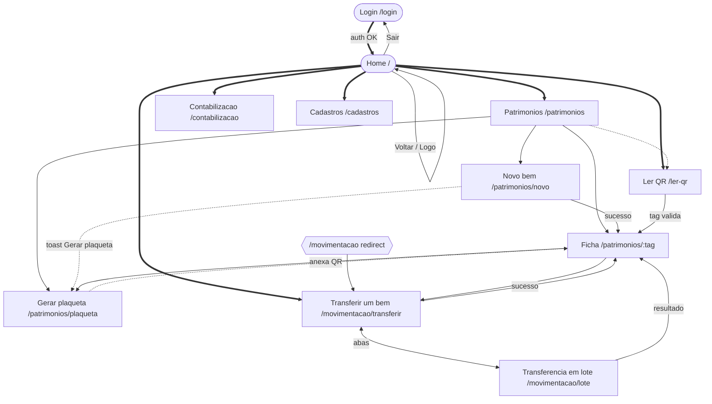
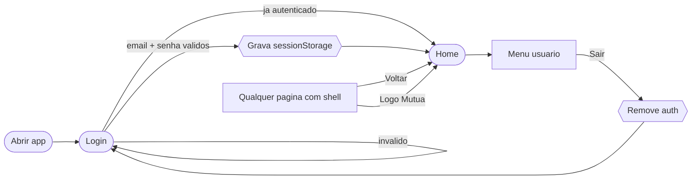
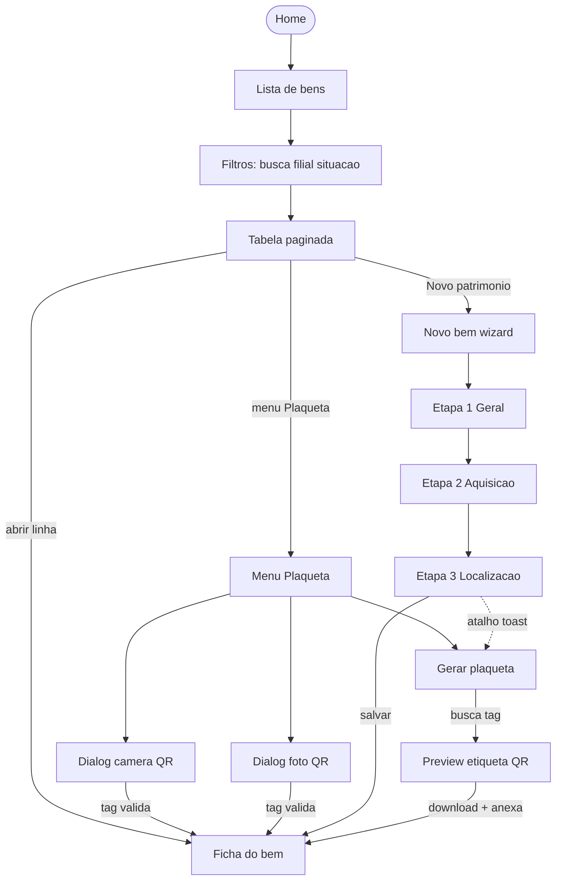
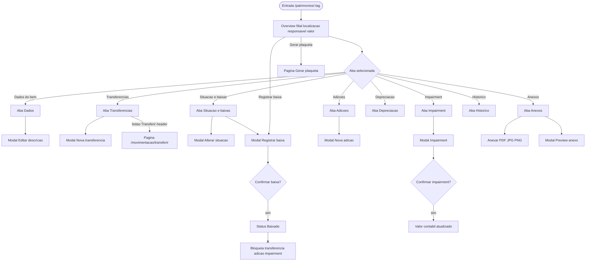
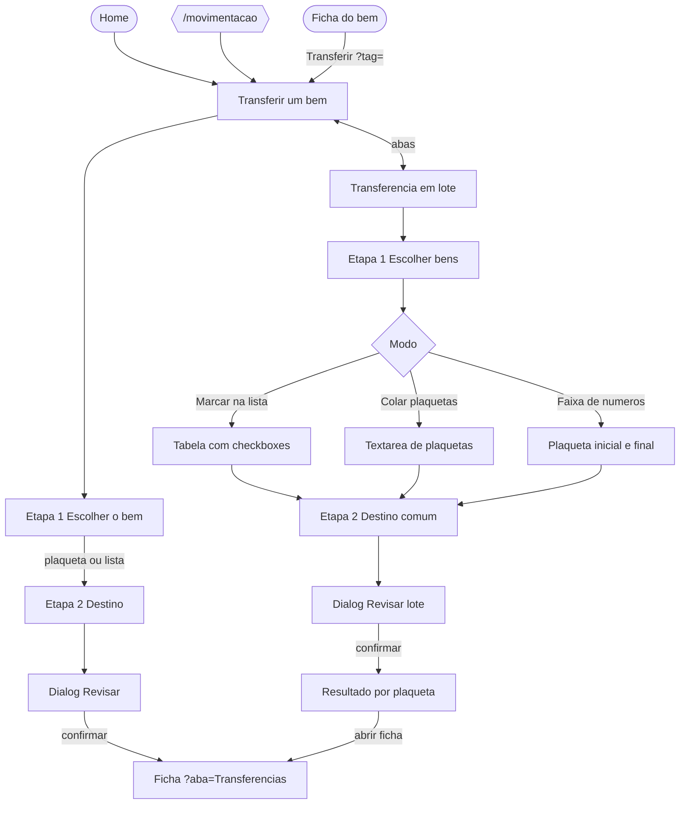
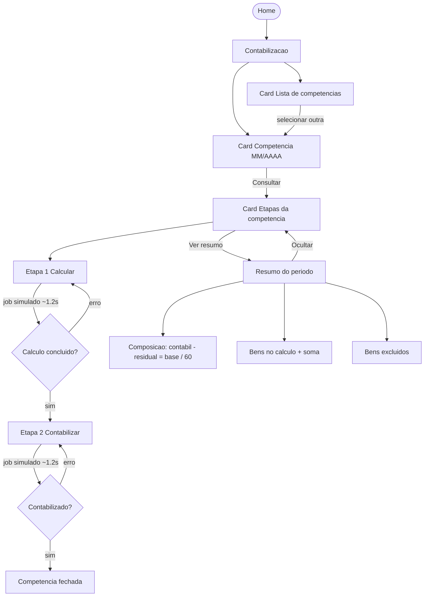
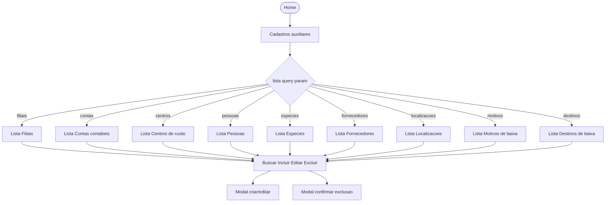
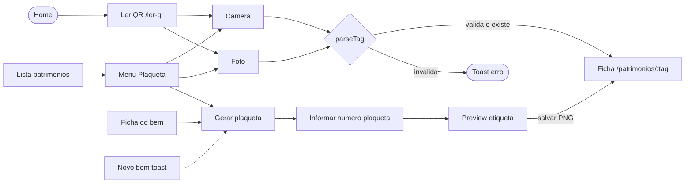
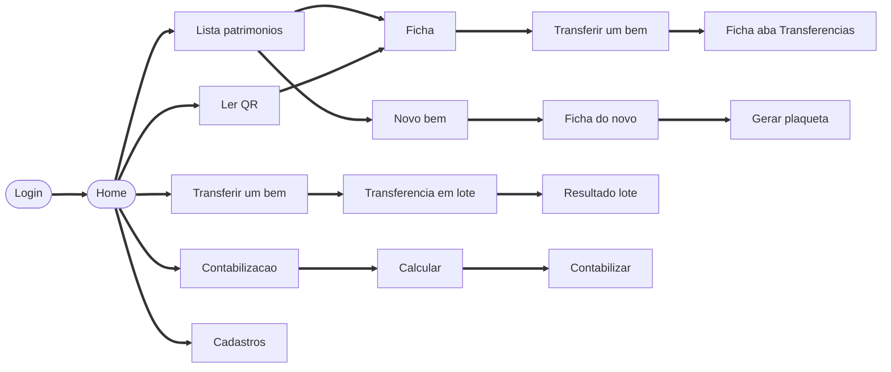

# Fluxos de Paginas — Gestao de Patrimonio Mutua

> **Prototipo front-end.** Os fluxos abaixo refletem o comportamento atual, com dados na sessao do navegador, login simulado e jobs de contabilizacao simulados. Regras, persistencia e autenticacao serao fechadas na integracao com o backend.

Documento otimizado para o Figma MCP (`generate_diagram` / FigJam).
Cada bloco Mermaid abaixo pode ser colado ou enviado direto ao plugin para gerar o diagrama editavel.

## Como usar no Figma

1. Pedir ao Cursor: "gere este diagrama no FigJam" apontando um bloco `mermaid` abaixo.
2. Ou usar `/figma-generate-diagram` com o conteudo do bloco.
3. Preferir **um diagrama por secao** (nao juntar tudo em um so) — o layout do FigJam fica legivel.
4. Regras do Mermaid no FigJam:
   - sem emojis
   - IDs em camelCase
   - labels com caracteres especiais entre aspas
   - nao usar `end`, `subgraph` ou `graph` como ID de no
   - direcionamento unico por diagrama (`LR` ou `TD`)

## Inventario de telas (todas)

Use esta lista ao criar frames de UI no Figma Design. Cada linha = 1 tela/frame.

| ID | Rota | Nome do frame | Tipo |
|----|------|---------------|------|
| login | `/login` | Login | pagina |
| home | `/` | Home - Modulos | pagina |
| patrimList | `/patrimonios` | Patrimonios - Lista | pagina |
| patrimNovo | `/patrimonios/novo` | Patrimonios - Novo bem | pagina |
| patrimFicha | `/patrimonios/:tag` | Patrimonios - Ficha | pagina |
| patrimPlaqueta | `/patrimonios/plaqueta` | Patrimonios - Gerar plaqueta | pagina |
| movEntrada | `/movimentacao` | Redireciona para Transferir um bem | redirect |
| movUm | `/movimentacao/transferir` | Movimentacao - Transferir um bem | pagina |
| movLote | `/movimentacao/lote` | Movimentacao - Transferencia em lote | pagina |
| contab | `/contabilizacao` | Contabilizacao | pagina |
| cadastros | `/cadastros` | Cadastros auxiliares | pagina |
| lerQr | `/ler-qr` | Ler QR Code | pagina |
| notFound | `not-found` | Pagina nao encontrada | sistema |
| errorPage | `error` | Erro da aplicacao | sistema |

### Telas internas (modais / estados da mesma rota)

| ID | Onde aparece | Nome do frame |
|----|--------------|---------------|
| fichaTabDados | Ficha | Ficha - Aba Dados do bem |
| fichaTabTransf | Ficha | Ficha - Aba Transferencias |
| fichaTabSituacao | Ficha | Ficha - Aba Situacao e baixas |
| fichaTabAdicoes | Ficha | Ficha - Aba Adicoes |
| fichaTabImpairment | Ficha | Ficha - Aba Impairment |
| fichaTabDepreciacao | Ficha | Ficha - Aba Depreciacao |
| fichaTabAnexos | Ficha | Ficha - Aba Anexos |
| fichaTabHistorico | Ficha | Ficha - Aba Historico |
| modalDescricao | Ficha | Modal - Editar descricao |
| modalTransf | Ficha | Modal - Transferir patrimonio |
| modalSituacao | Ficha | Modal - Alterar situacao |
| modalBaixa | Ficha | Modal - Registrar baixa |
| modalAdicao | Ficha | Modal - Incorporar adicao |
| modalImpairment | Ficha | Modal - Registrar impairment |
| modalConfirmBaixa | Ficha | Modal - Confirmar baixa |
| modalConfirmImp | Ficha | Modal - Confirmar impairment |
| modalPreviewAnexo | Ficha | Modal - Preview de anexo |
| dialogQrCamera | Lista / shell | Dialog - Ler QR (camera) |
| dialogQrFoto | Lista / shell | Dialog - Enviar foto do QR |
| umStep1 | Transferir um bem | Etapa 1 - Escolher o bem |
| umStep2 | Transferir um bem | Etapa 2 - Destino |
| umReview | Transferir um bem | Dialog - Revisar transferencia |
| loteStep1 | Movimentacao lote | Etapa 1 - Escolher bens (Marcar / Colar / Faixa) |
| loteStep2 | Movimentacao lote | Etapa 2 - Destino comum |
| loteReview | Movimentacao lote | Dialog - Confirmar lote |
| loteResultado | Movimentacao lote | Secao - Resultado do lote (somente nesta visita) |
| novoStep1 | Novo bem | Wizard - Etapa Geral |
| novoStep2 | Novo bem | Wizard - Etapa Aquisicao |
| novoStep3 | Novo bem | Wizard - Etapa Localizacao |
| contabPeriodo | Contabilizacao | Card - Competencia do periodo |
| contabCalc | Contabilizacao | Etapa 1 - Calcular periodo |
| contabPost | Contabilizacao | Etapa 2 - Contabilizar |
| contabResumo | Contabilizacao | Resumo do periodo (abre sob demanda) |
| contabLista | Contabilizacao | Card - Lista de competencias |
| cadDomain | Cadastros | Lista do dominio selecionado |
| cadCreate | Cadastros | Modal - Incluir / editar item |
| cadDelete | Cadastros | Modal - Excluir item |

---

## DIAGRAMA 01 — Mapa mestre de paginas (todas as rotas)

Copiar este bloco para o FigJam. Cobre login, home e todas as paginas subsequentes.



---

## DIAGRAMA 02 — Autenticacao e shell

Login simulado: qualquer e-mail valido e senha preenchida entram. No prototipo, as rotas internas ainda nao exigem login; a protecao vem com a autenticacao do backend.



---

## DIAGRAMA 03 — Modulo Patrimonios (lista + subsequentes)



---

## DIAGRAMA 04 — Ficha do bem (abas e modais)

Todas as subsequentes da ficha, sem ficar so na pagina inicial do bem.



---

## DIAGRAMA 05 — Movimentacao (um bem + lote)

A entrada padrao e Transferir um bem; as abas alternam entre os dois fluxos.



---

## DIAGRAMA 06 — Contabilizacao (etapas subsequentes)

Pagina em coluna unica (cards empilhados). O resumo fica oculto ate o usuario clicar em "Ver resumo do periodo".



Regra da projecao (prototipo): `residual = min(contabil, aquisicao x residual%)`, `base = contabil - residual`, `mensal = base / 60`. A contabilizacao nao altera o valor contabil dos bens nesta versao.

---

## DIAGRAMA 07 — Cadastros auxiliares (todas as listas)



---

## DIAGRAMA 08 — QR Code e plaqueta (entradas alternativas)



---

## DIAGRAMA 09 — Jornada usuario completa (critica)

Caminho feliz do login ate as principais subsequentes.



---

## Prompt pronto para o Cursor / Figma

Cole isto no chat quando quiser gerar os fluxos no FigJam:

```
Use o MAPA-PROJETO.md e gere no FigJam (generate_diagram) os diagramas 01 a 09,
cada um em um diagrama separado no mesmo arquivo FigJam se possivel.
Nao pule paginas subsequentes: ficha com abas, modais, lote, contabilidade,
cadastros por dominio, QR e wizard de novo bem devem aparecer.
```

---

## Referencia rapida de edges (para nao perder subsequentes)

| De | Para | Trigger |
|----|------|---------|
| Login | Home | submit valido |
| Home | 5 modulos | Abrir card |
| Lista | Ficha | clique na linha |
| Lista | Novo | botao Novo patrimonio |
| Lista | Dialog QR / Plaqueta | menu Plaqueta |
| Novo | Ficha | cadastro OK |
| Novo | Plaqueta | acao do toast |
| Ficha | Transferir um | botao Transferir |
| Ficha | Plaqueta | botao Gerar plaqueta |
| Ficha | Modais | acoes das abas |
| Ficha Baixado | bloqueio | sem transferencia/adicao |
| Home / `/movimentacao` | Transferir um | card Movimentacao / redirect |
| Transferir um | Lote | aba Transferencia em lote |
| Lote | Transferir um | aba Transferir um bem |
| Lote | Etapa 2 Destino | Continuar para o destino |
| Lote | Dialog review | Revisar lote |
| Lote | Resultado | confirmar lote |
| Transferir um | Ficha?aba=Transferencias | sucesso |
| Contabilizacao | Calcular | Etapa 1 |
| Contabilizacao | Contabilizar | Etapa 2 apos calculo |
| Contabilizacao | Resumo do periodo | Ver resumo do periodo |
| Cadastros | 9 listas | `?lista=` |
| Ler QR | Ficha | tag reconhecida |
| Qualquer shell | Home | Voltar ao inicio, trilha Inicio ou Logo |
| Menu usuario | Login | Sair |
